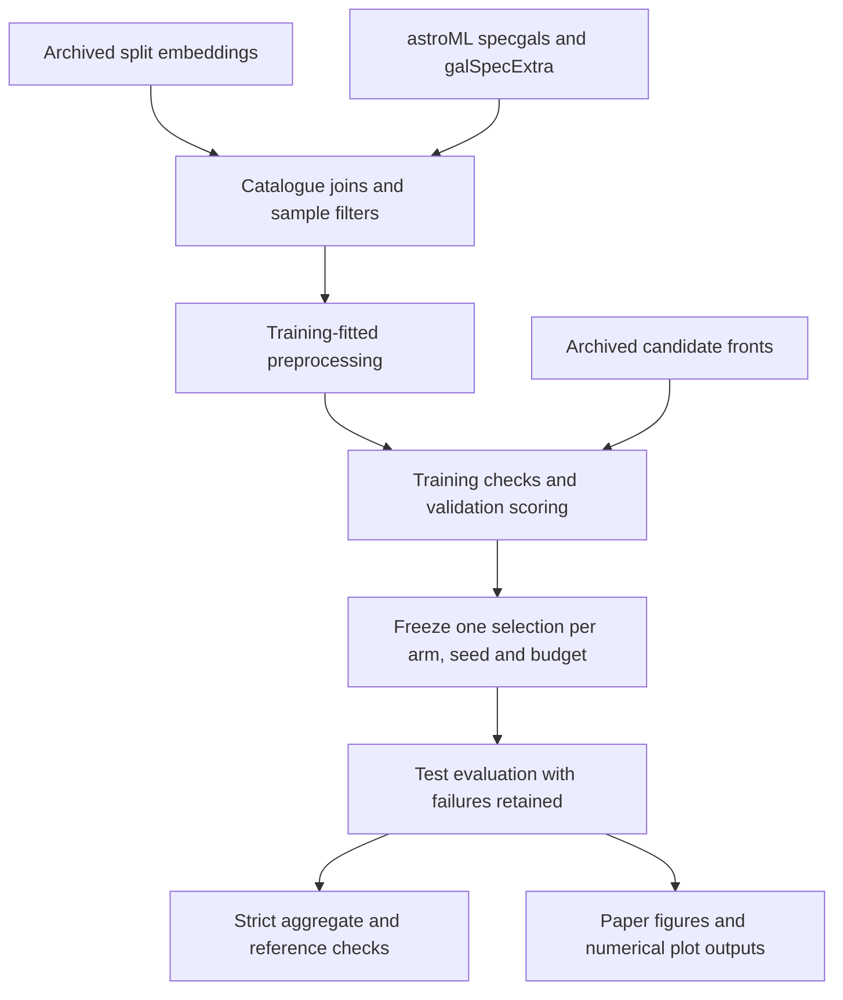

# Understand the code

The main prediction target is `lgm_tot_p50`, the adopted catalogue estimate of
log10 stellar mass in solar units. The package compares six input arms:

The lowercase target column comes from astroML; the separately joined
galSpecExtra FITS mass column is uppercase. They agree exactly on the retained
archived sample. See [the data preparation review](DATA_REVIEW.md) for the
join sequence, checks, and proposed validation improvements.

| Arm | Predictors |
|---|---|
| `orig` | Original Spender spectral latents |
| `cond` | Redshift-conditioned flow coordinates |
| `uncond` | Unconditional flow coordinates |
| `z` | Redshift alone |
| `orig+z` | Original latents with redshift appended |
| `cond+z` | Conditional coordinates with redshift appended |

Latent coordinates are standardised using the full cleaned training split.
Redshift is appended without rescaling. Each search seed draws 10,000 training
rows without replacement; validation and test use their cleaned splits.

## Data flow

## Read the main workflow in this order

1. [`cli.py`](../src/wwdc_repro/redshift/cli.py), `run`: orchestrates the analysis,
   saves frozen selections before test evaluation, and writes manifests/checks.
2. [`data.py`](../src/wwdc_repro/shared/data.py), `load_sample`, `clean_target`, and
   `matrices`: joins catalogues by spectrum ID, filters rows, and builds features.
   The split is by spectrum; physical galaxies are not guaranteed disjoint.
3. [`frontier.py`](../src/wwdc_repro/redshift/frontier.py), `score_fronts`: evaluates
   printed candidates on the training subsample and validation set. Independent
   training references, including hash-bound recovered scores, check that an
   exported expression reproduces its training score within the tolerance.
4. `select_by_budget`: chooses the eligible equation with the best validation
   R² for each arm/seed/maximum length, preferring shorter equations on a tie.
5. `evaluate_selected` and `curves`: evaluate frozen choices on test and retain
   failures. An aggregate with a failed seed has no finite mean/range.
6. [`equations.py`](../src/wwdc_repro/shared/equations.py): parses exported expressions
   and supplies their numerical evaluation.

The prediction object is the exported equation, not the original Operon tree.
Coefficient rounding can change domain validity near singularities; see the
[selection audit](SELECTION_AUDIT.md). Test performance never chooses a
replacement in the main analysis.

The [equation/selection review](EQUATION_SELECTION_REVIEW.md) checks all 447
current choices and documents the evaluator's simplification and failure rules.

## Figures

[`figures.py`](../src/wwdc_repro/redshift/figures.py) provides `wwdc-figures` and routes
each panel to its calculation. `frontier_display` implements the explicitly
test-informed display fallback used in the manuscript; it does not alter
selection records. [`paper_panels.py`](../src/wwdc_repro/redshift/paper_panels.py) contains
`anatomy`, `zero_latent`, and `cmd`. The corner plot is in
[`latent_corner.py`](../src/wwdc_repro/redshift/latent_corner.py), and the coefficient
table is in [`weights.py`](../src/wwdc_repro/redshift/weights.py).

Use [FIGURES.md](FIGURES.md) for exact panel inputs, score definitions, bins,
and numerical outputs. In particular, fixed-score anatomy curves are not
uncertainty intervals for observed masses.

## Supporting commands and artifacts

| Location | Responsibility |
|---|---|
| [`catalogue.py`](../src/wwdc_repro/shared/catalogue.py) | Downloads pinned CMD mirror inputs and builds the historical join |
| [`embedding.py`](../src/wwdc_repro/shared/embedding.py) | Runs checkpoint inference through the pinned upstream implementation |
| [`mlp_probe.py`](../src/wwdc_repro/redshift/mlp_probe.py) | Reproduces the matched embedding MLP comparison |
| `artifacts/fronts/` | Archived candidate equations; inputs to the main workflow |
| `reference.json` | Expected sample and analysis checks |
| `recovered_training_scores.json` | Independent native training references and provenance |
| [`tests/test_selection.py`](../tests/test_selection.py) | Checks selection/test separation and failure handling |
| [`experiments/`](../experiments/README.md) | Historical search reruns, recovery audit, and paper conditioning workflows |

The two JSON reference files are packaged under `src/wwdc_repro/`. Historical
search modules are deliberately hash-pinned: edits to those vendored modules
invalidate the rerun wrapper's provenance check. They should not be tidied
incidentally while improving documentation.

## What the saved-search workflow does not establish

Reevaluating saved fronts does not rerun the search, retrain embeddings, prove
catalogue correctness, or guarantee physical-galaxy independence across splits.
Exact matches for particular seeded searches are runtime-specific evidence.
For completed checks and remaining limitations, read [VALIDATION.md](VALIDATION.md)
and [PROVENANCE.md](PROVENANCE.md).
